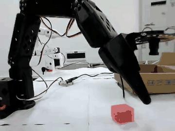
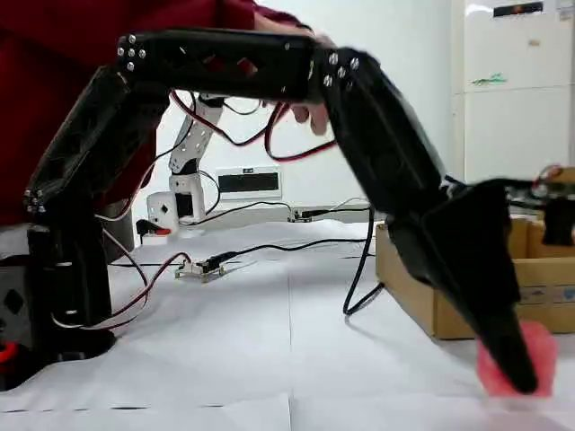
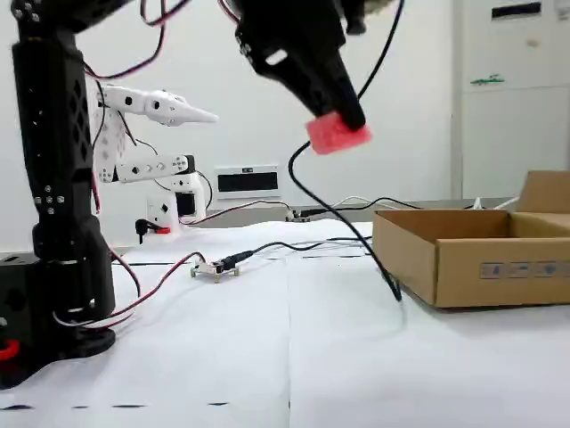

# SO-100 机械臂：语言交互控制 + ACT 模仿学习抓取

> A 6-DOF SO-100 arm with four capabilities: **(1) natural-language control through an LLM + MCP tool server**, **(2) end-to-end vision-based grasping learned from 50 human demonstrations with ACT**, **(3) master-slave teleoperation** written directly on the Feetech SDK, and **(4) colour-based block detection / tracking**. All numbers below are measured on real hardware, not estimated.

一台 6 自由度 SO-100 机械臂的四条能力线：

| 能力          | 实现                                                           | 你说话 / 它自己动                         |
| ----------- | ------------------------------------------------------------ | --------------------------------- |
| **语言控制**    | DeepSeek + MCP 工具服务端，模型自主选择调用 `set_student_servo_angles` 等工具 | “把夹爪张开”“手臂抬一点”“讲个故事再读出来”         |
| **自主抓取**    | ACT（Action Chunking Transformer）视觉策略，2 路相机 → 6 维关节角          | 从初始位伸出 → 夹住积木 → 放进纸盒              |
| **主从遥操作**   | 直接调飞特 SDK 的同步读写，带低通滤波 / 死区 / 比例与中位补偿                        | 手推 leader 臂，follower 实时跟随          |
| **积木视觉定位**  | OpenCV 颜色阈值 + 面积/尺寸测量 + 质心轨迹                                 | 相机画面里直接框出积木并标尺寸                   |



<p align="center">
  
  
</p>

---

## 一、实测结果

### 数据集

| 项目        | 数值                                               |
| --------- | ------------------------------------------------ |
| 演示条数 / 帧数 | **50 条 / 13 009 帧**                              |
| 总时长       | 433.6 s（≈7.2 分钟），单条 7.3–19.3 s，中位数 8.2 s         |
| 观测        | 2 路 RGB（侧视 640×480 + 俯视 640×480）@30 fps + 6 维关节角 |
| 动作        | 6 维关节角（度），预测未来 100 步                             |

### 模型与训练

| 项目     | 数值                                                                                     |
| ------ | -------------------------------------------------------------------------------------- |
| 模型     | ACT，**51.6 M** 参数（ResNet18 主干 + 4 层编码器 / 1 层解码器 Transformer + VAE）                     |
| 训练     | 40 000 步 × batch 8 ≈ 24.6 epoch，**RTX 4060 Laptop 上 3 小时 47 分**，显存峰值 5.7 GB            |
| 收敛     | l1_loss：10k `0.0957` → 20k `0.0713` → 30k `0.0605` → 40k **`0.0545`**（降 43%，**仍未平台期**） |
| 动作预测误差 | 100 步动作块 **1.52°**，首步（实际下发）1.70°                                                       |
| 单次推理   | 4060 上 **2.3 ms**（p95 2.7 ms），显存 285 MiB，fp32 权重 197 MiB → INT8 约 49 MiB               |

### 真机评估

| 配置                      | 轮数  | 完成（积木进盒 / 夹住）               |
| ----------------------- | --- | --------------------------- |
| 每轮 10 s，动作块 100 步一次性盲执行 | 30  | 约 **20 %**                  |
| 每轮 20 s，**每 10 步重新规划**  | 15  | **47–67 %**（另有 3 轮夹住但超时未放下） |

**速度对比**（同一段动作，从折叠位到积木）：人类演示 4.8 s，模型 7.7 s；但模型关节峰值速度（208 °/s）反而高于演示（163 °/s）——
说明瓶颈是**轨迹有多余修正**，不是电机不够快。

---

## 二、仓库结构

```
so100-act-grasp/
├─ src/                      # 语言控制线（轻量，只依赖 openai + mcp + pyserial）
│  ├─ mcp_server.py          # MCP 工具服务端：数学/文件搜索/舵机/离线 TTS
│  ├─ chat_client.py         # DeepSeek 对话客户端（自动多轮工具调用）
│  ├─ deepseek_mcp_integration.py  # 可复用的集成类
│  └─ mcp_client_min.py      # 最小连通性测试
├─ scripts/                  # 机械臂线：诊断 / 数据 / 训练 / 评估
│  ├─ probe_servo_bus.py     # 舵机总线探测（协议 + 波特率 + 型号识别）
│  ├─ probe_cameras.py       # 相机索引与视角核对
│  ├─ check_robot_connect.py # 只连设备、读一帧、读一次角度（不动作）
│  ├─ check_send_action.py   # 5° 小幅运动验证下发链路
│  ├─ consolidate_dataset.py # 从 episode + PNG 帧重建可训练数据集
│  ├─ check_convergence.py   # 跨 checkpoint 对比动作误差（判断是否该继续训）
│  ├─ export_metrics.py      # 导出 l1 / MAE（度）
│  ├─ measure_latency.py     # 单次推理延迟（端侧部署基线）
│  ├─ compare_speed.py       # 演示 vs 策略的动作节奏对比
│  └─ summarize_eval.py      # 评估批次汇总（动作形态 + 末帧拼图）
├─ teleop/                   # 独立主从遥操作（不依赖 lerobot，跟随参数全可调）
├─ perception/               # 颜色阈值积木检测 / 尺寸测量 / 轨迹跟踪（含局限性说明）
├─ tools/                    # 舵机监视（终端 + GUI）、相机取景、标注整理
├─ third_party/scservo_sdk/  # 飞特官方 SDK（MIT），随仓库分发，免 pip 安装
├─ examples/                 # 舵机 GUI 滑条、离线 TTS 最小示例
├─ docs/                     # 硬件、MCP、训练流程、模型报告、补丁、失败分析
└─ figures/                  # README 用图
```

**本仓库不包含 lerobot / GenkiBot 源码**（体积大且是 Apache-2.0 的 fork）。训练依赖它们的修改版，
我对它的 4 处修复记录在 [docs/patches.md](docs/patches.md)，可自行打到 upstream lerobot 上。

---

## 三、快速开始

### 1. 语言控制（不需要机械臂也能跑）

```bash
pip install -r requirements.txt
# 终端 1
python src/mcp_server.py            # 默认 http://localhost:8000/sse
# 终端 2
$env:DEEPSEEK_API_KEY = "sk-..."    # PowerShell；仓库内不含任何密钥
python src/chat_client.py
```

> 它会给模型 7 个工具：`add/sub/mul/div`、`file_search`、`set_student_servo_angles`（六轴）、
> `set_student_servo_angle`（单轴）、`tts_speak`。系统提示词里定义了“1 号腰 / 2 号大臂 / 3 号小臂 /
> 4、5 号腕 / 6 号夹爪”，所以可以直接说“夹爪张开一点”。

### 2. 硬件体检（30 秒，不下发任何运动）

```bash
python scripts/probe_servo_bus.py --ports COM5 COM6 --sdk   # 协议/波特率/型号（777 = STS3215）
python scripts/probe_cameras.py                             # 相机索引 + 每个 index 的截图
python scripts/check_robot_connect.py                       # 两臂 + 两路相机连通性
```

### 3. 主从遥操作与调试工具

```bash
python teleop/master_slave_teleop.py     # 手推 leader，follower 跟随（不依赖 lerobot）
python tools/read_6_servos.py            # 终端里同步读 6 轴（查 ID / 查抖动最快）
python tools/servo_angle_monitor.py      # 同上，Tkinter 图形界面
```

跟随增益（速度/加速度）、死区、低通系数、中位补偿都在 `teleop/master_slave_teleop.py`
顶部集中配置，含义见 [teleop/README.md](teleop/README.md)。

### 4. 训练与评估

完整命令见 [docs/03-train-act.md](docs/03-train-act.md)：采集 → 组装 → 训练 → 真机评估 → 指标导出。

### 5. 脚本的路径约定

`scripts/` 下的脚本默认按“当前目录 = 你的 lerobot fork（如 `genkiarm/`）”解析路径，
也可以用环境变量覆盖，避免改代码：

| 环境变量                | 默认值                                         | 用途        |
| ------------------- | ------------------------------------------- | --------- |
| `LEROBOT_DATA`      | `data`                                      | 数据集根目录    |
| `ACT_CHECKPOINTS`   | `outputs/train/act_so100_50eps/checkpoints` | 训练产物目录    |
| `EVAL_ANALYSIS_DIR` | `eval_analysis`                             | 评估汇总图输出目录 |
| `CAMERA_PROBE_DIR`  | `camera_probe`                              | 相机截图输出目录  |
| `CAMERA_INDEX`      | `1`                                         | 感知/取景脚本用的相机索引 |
| `REF_BLOCK_IMAGE`   | `blue_block_capture.jpg`                    | 像素/厘米标定用的参考图 |
| `LABELME_DIR`       | `.`                                         | JSON→TXT 的输入目录 |
| `SEARCH_ROOT`       | `D:\`                                       | `file_search` 工具的默认搜索根目录 |

---

## 四、实现要点（踩过的坑在这里）

1. **舵机协议不一致**：leader 臂被配成 `0xAA` 帧的 `GBotMotorsBus`，而实际上两条臂都是 STS3215（`0xFF` 帧、1 Mbaud、型号码 777）。
   用 `probe_servo_bus.py` 两种协议同时试探才定位到，换回 `FeetechMotorsBus` 后一次点亮。
2. **Windows 上 `ffmpeg` 不在 PATH**：`record` 结束后编码 mp4 抛 `WinError 2`，导致数据集只有 `.pth` 和 PNG、
   没有 `train/` 和 `meta_data/`。修复：优先用 `imageio-ffmpeg` 自带二进制 + 编码器改 `libx264`，并写了
   `consolidate_dataset.py` 从已有帧重建（50 条数据一条没丢）。
3. **OpenCV 的 MSMF 后端打开相机要 5–28 秒且偶发静默崩溃**：改为优先 DirectShow，打开时间降到 1.6–2.1 秒。
4. **退出后舵机锁死**：`disconnect()` 前先写 `Torque_Enable=0`，否则只能断电才能手动回位。
5. **`--num-episodes` 是累计集数而不是“再录几集”**：复用同一个 `--repo-id` 时第二次会立刻退出、机械臂一动不动。
   改用 `--force-override 1` 或每次换 id。

细节与代码片段见 [docs/patches.md](docs/patches.md)。

---

## 五、局限

- **仍是欠训练状态**：40k 步的 l1 仍以每万步约 11 % 下降，未出现平台期；计划续训到 100k。
- **成功率 50–70 %**，还不足以稳定交付；失败模式主要是“伸到积木上方半途停住”。
- **标定是初始占位值**（`homing_offset` 全 2048、`drive_mode` 全 1）。采集与推理用同一套值所以自洽，
  但没有物理零点；**若重新标定或换臂，必须重新采集数据**。
- **场景固定**：积木位置、纸盒位置与演示基本一致时才可靠，位置随机化会明显掉点。
- 时序集成（`temporal_ensemble_coeff`）在本任务上实测**更差**（10 轮 0 成功），已放弃，原因写在
  [docs/05-lessons.md](docs/05-lessons.md)。
- **自动评测还没有闭环**：目前成功率靠“动作形态数值 + 末帧拼图目视”。
  `perception/` 里的颜色阈值法能定位积木，但在本场景下不足以当判据（红色线束干扰、相机随臂移动），
  详见 [perception/README.md](perception/README.md)。下一步是固定外置相机 + 检测模型。

---

## 六、许可

本项目代码 MIT。第三方组件见 [LICENSE](LICENSE) 末尾的说明；lerobot 为 Apache-2.0，本仓库不包含其源码。

---

## 七、硬件清单

SO-100 结构 6-DOF 主从臂 ×2（leader/follower）、飞特 STS3215 舵机 ×12、CH343 USB 转串口 ×2、
USB 摄像头 ×2（侧视 + 俯视）、12 V 舵机电源。详见 [docs/01-hardware.md](docs/01-hardware.md)。
